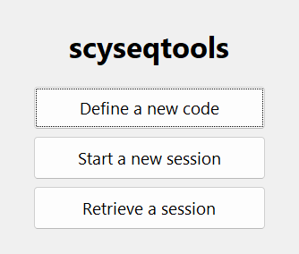
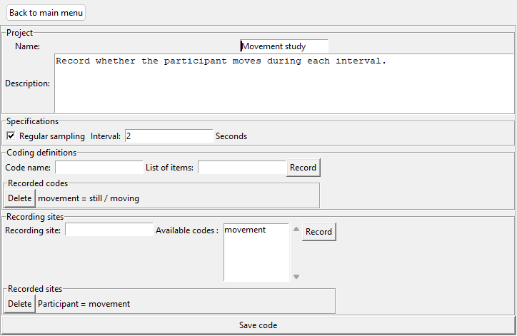
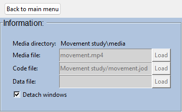
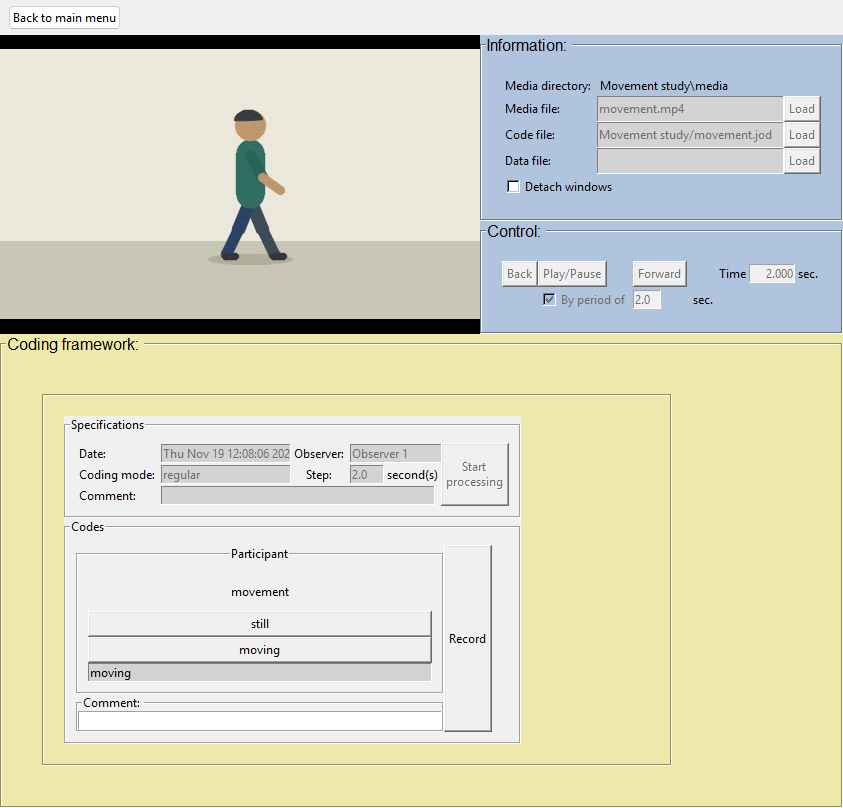
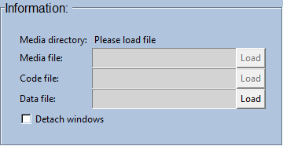

<h1 align="center">ScySeqTools</h1>

  
  
  
  

ScySeqTools provides desktop applications for researchers and observers who
study behaviour using recordings. It helps turn recorded observations into
structured data that can be saved, compared, and analysed to investigate
behavioural patterns.

In this context, **coding** means systematically assigning labels to observed
behaviours. Observers use a **coding scheme**: a defined set of categories and
rules describing what each label means and when to apply it. Clear definitions
help different observers apply the labels consistently. Recording these labels
over time creates a sequence of observations for analysis. This approach is
described in the research guidelines for
[systematic coding of observed human behaviour](https://link.springer.com/article/10.1007/s11135-024-01969-9).

ScySeqTools supports this workflow through two graphical applications. The
**Encoder** lets you define your labels and record observations while reviewing
media. The **Analyser** works with the resulting coded sequences to summarise
label frequencies, examine transitions and relationships between sequences, and
assess agreement between observers. No programming is required to use the apps.

If you already have coded sessions (`.cdx` files), you can
start with the Analyser.

**[Download the apps for Windows or Ubuntu](https://github.com/scyseq-tools/scyseqtools/releases/latest)**

## Download and open an app

Under **Assets** on the release page, download the archive for each app you
want. Both apps include Python. In the filenames below, `<version>` stands for
the version shown on the release page.

| Your computer | Encoder download | Analyser download |
| --- | --- | --- |
| Windows, 64-bit Intel/AMD | `ScySeqTools-Encoder-windows-x64-<version>.zip` | `ScySeqTools-Analyser-windows-x64-<version>.zip` |
| Ubuntu, 64-bit Intel/AMD (built on 22.04) | `ScySeqTools-Encoder-ubuntu-22.04-x64-<version>.tar.gz` | `ScySeqTools-Analyser-ubuntu-22.04-x64-<version>.tar.gz` |

**Windows**

1. If you are using the Encoder, install 64-bit VLC in its default folder, `C:\Program Files\VideoLAN\VLC`. [Download VLC for Windows](https://www.videolan.org/vlc/download-windows.html)
2. Right-click the downloaded ZIP and choose **Extract All**.
3. In the extracted folder, double-click `ScySeq Encoder <version>.exe` or `ScySeq Analyser <version>.exe`. Windows may hide the `.exe` ending.

**Ubuntu**

1. If you are using the Encoder, install VLC and MediaInfo by running `sudo apt install vlc libmediainfo0v5` in a terminal.
2. Right-click the downloaded archive and choose **Extract Here**.
3. Open a terminal in the extracted folder. Type `./scyseq-encoder-` or `./scyseq-analyser-`, press **Tab** to complete the versioned filename, then press **Enter**. If you see “Permission denied”, open the file’s **Properties → Permissions**, enable **Allow executing file as program**, and try again.

## Your first project

### 1. Open the Encoder

In this example, you’ll watch a participant and record whether they move during
each two-second interval. You can follow along with your own short recording.
Open the Encoder and choose **Define a new code**.

### 2. Define the labels and who they apply to

1. Under **Project**, enter `Movement study` as the **Name** and describe what you’ll observe. Check **Regular sampling** and enter `2` in **Interval** for two-second observations.
2. Under **Coding definitions**, enter `movement` in **Code name** and `still, moving` in **List of items**. Click **Record** on that row. You’ll see `movement = still / moving` under **Recorded codes**.
3. Under **Recording sites**, enter `Participant` in **Recording site**, select `movement` under **Available codes**, and click **Record** on that row. Check that **Recorded sites** shows `Participant = movement`.
4. Click **Save code** and save the definition as `movement.jod`. The Encoder returns to the home screen.

### 3. Load the recording and start a session

Choose **Start a new session**. In **Information**, click **Load** beside
**Media file** and open your recording. Then click **Load** beside **Code file**
and open `movement.jod`. Leave **Data file** empty for a new session. In the
**Coding framework** window, click **Start processing** and enter your observer
name when prompted (the example uses `Observer 1`).

### 4. Watch an interval and record what you saw

Clear **Detach windows** in **Information** to bring the video, playback controls,
and labels into one window as shown below. Click **Play/Pause** to watch the first
two seconds. When playback pauses, choose **moving** if the participant moved
during that interval, or **still** if they stayed still. Your choice appears below
the two labels. Click **Record** to save it.

On the first save, choose your project folder, then save the session as
`session-01.cdx` in the suggested `data` folder. For each following interval,
click **Play/Pause**, choose a label, and click **Record**. Each observation
updates the same `.cdx` file.

### 5. Reopen a saved session

Choose **Back to main menu**, confirm, then choose **Retrieve a session**.
Click **Load** beside **Data file** and open `session-01.cdx`. Keep the recording
and `movement.jod` in their original locations so the Encoder can reopen them.
Click **Start processing** and enter the same observer name. The Encoder shows
your last recorded label. Click **Play/Pause** to observe the next interval.

### See your results in the Analyser

In the Analyser, click **Choose data directory** and open the folder containing your `.cdx` file. Highlight it under **Available files** and click **Select file(s)**. Open **Statistics**, highlight your site, and click **Select** to see its codes. Choose your code, click **Launch**, and choose an output folder. Open the resulting `.csv` in a spreadsheet to see the sequence length and label frequencies.

For other analyses and Encoder settings, read the [full user guide](https://scyseq-tools.github.io/scyseqtools/userguide.html).
If you need help, include your operating system, app version, and what happened in the [issue tracker](https://github.com/scyseq-tools/scyseqtools/issues).
