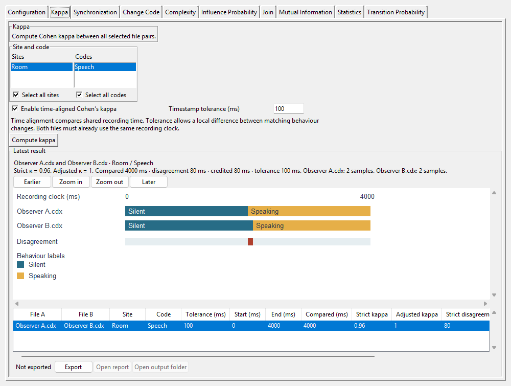

User Guide
==========

The Encoder lets you apply labels to behaviours as you watch a recording.
A coding scheme defines what each label means and when observers should use
it. For guidance on designing a scheme, see the research guidelines for
`systematic coding of observed human behaviour <https://link.springer.com/article/10.1007/s11135-024-01969-9>`_.
The Analyser uses the `Scyseq library <https://scyseq-tools.github.io/scyseq/>`_
to analyse the resulting sequences.

Installation
------------

For the Windows and Ubuntu desktop apps, follow the
`download and launch instructions <https://github.com/scyseq-tools/scyseqtools#download-and-open-an-app>`_.
The downloads include Python. The Encoder also needs 64-bit VLC on Windows,
or VLC and the MediaInfo library on Ubuntu.

If you use a Python environment with Tk support, you can install both apps with:

.. code-block:: bash

   python -m pip install scyseqtools

Encoder Guide
-------------

Open the extracted Encoder app. For a Python installation, run ``scyseq-encoder``.

The encoder opens directly to the home screen. Choose a task or close the
window to exit. You can browse for existing files immediately.

For a graphical version of the encoder workflow, open the
:ref:`encoder-workflow-flowchart` on the flowcharts page.

Project Setup
^^^^^^^^^^^^^

The first time you record a new session during a launch, choose a project
folder. The encoder creates its ``data/`` subfolder if needed
and opens **Save As** there. You can save elsewhere. The project selection
lasts until you close the encoder, including when you return to the home screen.

The encoder suggests existing ``media/`` and ``data/`` subfolders for browsing.

For a new project, first define a code file, then start a coding session. For an
existing project, load an existing ``.jod`` code file or retrieve an unfinished
``.cdx`` session.

Define a Code
^^^^^^^^^^^^^

On the encoder home screen, click **Define a new code**.

Fill in the requested fields:

1. In the *Project* section, enter the project *Name* and *Description*.
2. In the *Specifications* section, enable **Regular sampling** only if the
   code should use fixed time intervals. Enter the *Interval* in seconds.
   Leave it disabled for continuous coding.
3. In *Coding definitions*, enter each *Code name* and its *List of items*,
   then click **Record**. For example, a ``movement`` code might use items
   such as ``small`` and ``large``.
4. In *Recording sites*, enter each *Recording site*, select the relevant
   *Available codes*, then click **Record**.
5. Click **Save code** to open **Save As**. Choose any folder and keep or edit
   the suggested filename, which uses the project name. Cancelling keeps your
   code definition open for editing.

The encoder saves the ``.jod`` code file and its matching ``.html`` report together,
then returns to the home screen.

New Session
^^^^^^^^^^^

On the home screen, click **Start a new session**.

1. Click **Load** in the *Media file* row and select a media file, normally
   from ``media/``.
2. Click **Load** in the *Code file* row and select the ``.jod`` code file,
   normally from ``data/``.
3. Use **Play/Pause**, **Forward**, and **Back** to navigate the media.
4. If you need fixed playback steps, enable **By period of** and enter the
   number of seconds.
5. Click **Start processing** and enter the observer or coder name.
6. Select one item for each displayed code, click **Record**, and repeat the
   play, code, record cycle.

To edit previous codes, click **Back** to reach the desired segment, restart the
video if needed, correct the selected items, and click **Record**.

The first **Record** prompts you to choose a project folder if needed, then
to save a ``.cdx`` data file. Cancelling keeps your selections and comment ready
to retry with **Record**. Once you choose a project, retry opens **Save As**.
Later records update the same session file. To exit, close the main
encoder window (the *Information* window in the detached layout).

Resume Session
^^^^^^^^^^^^^^

On the home screen, click **Retrieve a session**.

1. Click **Load** in the *Data file* row.
2. Select the desired ``.cdx`` session file wherever you saved it.
3. Click **Start processing**.
4. Enter the observer or coder name used for the original session.

The encoder restores the media file, code file, comments, and recorded steps,
then resumes from the last saved position. Each new record updates the opened
``.cdx`` file without asking for a project folder or filename.

.. _encoder-settings:

Encoder Configuration and Window Layout
^^^^^^^^^^^^^^^^^^^^^^^^^^^^^^^^^^^^^^^

On first run, the Encoder creates a personal ``config.ini``. A separate
``cwdfile.ini`` remembers the last project folder. The default locations are:

.. list-table::
   :header-rows: 1

   * - System
     - Personal settings
     - Last project folder
   * - Windows
     - ``%APPDATA%\ScySeqTools\Encoder\config.ini``
     - ``%APPDATA%\ScySeqTools\Encoder\cwdfile.ini``
   * - Ubuntu/Linux
     - ``~/.config/ScySeqTools/Encoder/config.ini``
     - ``~/.local/state/ScySeqTools/Encoder/cwdfile.ini``

The Encoder starts with its bundled defaults, then applies your personal
settings. When you start a workflow, any settings in the last project's
``config.ini`` take precedence. If you choose a different project folder while
saving, its settings take effect when you start the next workflow.

In **Start a new session** and **Retrieve a session**, use **Detach windows**
in *Information* at any time. Check it to move Control, Coding framework, and
Video into separate windows as you load them. Clear it to bring them together
with Information. Audio-only media uses just the controls. You can switch
while playing a clip or entering an observation and continue where you were.

The encoder remembers your choice for future sessions and launches. Before
your first checkbox change, it uses ``encoder_layout`` from your personal or
project ``config.ini``. The bundled setting is ``detached``. For example, to
start with a single window:

.. code-block:: ini

   [application]
   encoder_layout = embedded

Analysis Guide
--------------

Open the extracted Analyser app. For a Python installation, run ``scyseq-analyser``.

You can close the analyser with **Quit** on the *Configuration* tab or the
window's close button without selecting a folder. Cancelling **Choose data
directory** returns to the analyser and preserves the current selection.

For a graphical version of loading data, choosing an analysis, and saving
outputs, open the :ref:`analyser-workflow-flowchart` on the flowcharts page.

Analysis Workflow
^^^^^^^^^^^^^^^^^

1. Click **Choose data directory** and select the folder containing coded
   ``.cdx`` files.
2. Select one or more entries in *Available files*.
3. Click **Load checked files**. The *Loaded files* list shows the filenames
   and its heading shows the count. Check files in this list to remove them.
4. Choose an analysis tab and select the required sites, codes, sequences, and
   parameters.
5. Click the tab's **Compute** or **Launch** button.
6. Choose the output folder when prompted.

The analyser creates or uses an ``analyzer_files/`` folder next to the selected
data directory. Each analysis tab proposes a subfolder inside
``analyzer_files/`` as the default output location.

Analysis Tabs
^^^^^^^^^^^^^

Use these tabs according to the output you need:

* **Kappa** computes agreement for each selected file pair, site, and code.
  Select the sites and codes, then click **Compute kappa**. By default the
  tab matches complete observations by their media intervals and exports
  the wide CSV table. Select a comparison row to see its label-by-label heatmap.
  When several streams were compared, choose the site and code above the
  chart. Each cell counts samples, with the two filenames identifying the axes.
* **Statistics** summarizes sequence length and label frequencies. Choose a
  site and code, then click **Compute statistics**. Select a file in the
  results table to see its sample count and percentage bars. A frequency of
  0.75 in the table corresponds to 75% of observations in the chart.
* **Synchronization** computes synchronization likelihood, mutual information,
  and signed direction for a source site, target site, and shared code.
* **Mutual Information** computes mutual information between two selected
  sequences.
* **Complexity** computes normalized Lempel-Ziv complexity for one selected
  sequence.
* **Transition Probability** computes transition probabilities for one selected
  sequence and a step value.
* **Influence Probability** computes influence probabilities from a source
  sequence to a target sequence for a step value.
* **Join** combines two selected sequences and saves recoded ``.cdx`` output.
* **Change Code** recodes one selected sequence using a new code name,
  correspondence values, and alphabet labels.

Table-style analyses save ``.csv`` files. Recoding analyses such as **Join**
and **Change Code** save ``.cdx`` files that can be reused in later analyser
workflows.

Reviewing and exporting graphical results
^^^^^^^^^^^^^^^^^^^^^^^^^^^^^^^^^^^^^^^^^

Kappa and Statistics show the latest calculation in the tab before opening
the output-folder chooser. Select a row with the mouse or arrow keys to
change the chart. Cancelling the chooser keeps the result marked **Not
exported**. Use **Export** to save it later. Changing input files, options,
or tabs preserves the displayed run and its original filenames and settings.

An export writes the CSV and a printable HTML report in the same folder.
**Open report** opens the report in your browser, including charts for every
comparison or file. It works offline. Use your browser's Print command to
print or save a PDF. **Export again** lets you choose another destination,
and **Open output folder** shows the saved files. A failed export can be
retried. Closing the app or replacing a pending run offers to export,
discard, or cancel.

Sample-based Cohen's kappa
^^^^^^^^^^^^^^^^^^^^^^^^^^

Select files whose stored media paths refer to the same recording. If the
paths differ, the Analyser can verify them when both media files are accessible
and their contents match. Each CDX label describes the interval from its start
timestamp up to the next boundary. A stream with ``N`` labels requires
``N + 1`` finite, strictly increasing media timestamps in milliseconds.

Kappa compares complete intervals with matching start and end boundaries.
If recording ranges differ, the confirmation shows the overlap and the interval
that will be used for each affected pair. An observation cut by the edge of an
overlap can be omitted when the remaining observations match exactly. Different
sampling periods, incompatible grids, and pairs with no usable overlap stop
sample-based Kappa. The result details and HTML report record the source ranges,
the overlap, the compared interval, and the sample count for each site and code.

When all selected files lack complete timestamps, the Analyser can offer legacy
index-based Kappa. Proceed only if you can confirm that the observers coded the
same intervals in the same order. The export filename and report identify this
comparison as index-based.

Duration-weighted Cohen's kappa
^^^^^^^^^^^^^^^^^^^^^^^^^^^^^^^

Choose **Use duration-weighted Kappa** to measure agreement by elapsed media
time. The two streams can have different sampling grids when both sets of
timestamps define complete observation intervals on the verified media clock.

Strict kappa uses the intersection of the two observation windows on the
original clock. Within that window each label pair contributes its duration
to a contingency table. Observed agreement is the diagonal duration divided
by the compared duration. Expected agreement is the sum, over labels, of
the products of the two observers' proportions of time in that label.
Kappa is (observed − expected) / (1 − expected). The Analyser requires a
positive overlap. Expected agreement of one yields **N/A** and an explanation.

**Timestamp tolerance (ms)** defaults to zero. A positive value requests
SCYSEQ's boundary-tolerance variant alongside the strict result. Tolerance
is the maximum allowed difference between matched annotation boundaries.
Clock synchronization is a separate operation.

#. Merge consecutive identical labels into behavioural runs for transition
   detection. For each genuine transition inside the shared window, find
   transitions with the same before and after labels within the tolerance,
   including its upper limit.
#. Credit only mutually unique, ordered pairs. Ambiguous, crossing, or
   overlapping candidate spans keep their strict scores. The span between
   a matched pair must contain exactly those two changes. Recording-window
   boundaries and intervals containing additional changes receive no credit.
#. In a copy of the duration table, transfer the disagreement between the
   paired boundaries equally to the diagonal cells of the preceding and
   following behaviours. Recalculate observed and expected agreement using
   this adjusted table. This preserves total duration and both source files.

For example, on a four-second recording both observers change from silent to
speaking, one at 2000 ms and the other at 2080 ms. Strict kappa is 0.960.
With a 100 ms tolerance, 80 ms receives credit (40 ms per diagonal cell) and
adjusted kappa is 1. With the second boundary at 2120 ms, strict and adjusted
kappa are both 0.940 and credited disagreement is zero.

   The tracks show the original annotation boundaries. The summary reports
   how much of their disagreement received credit at the chosen tolerance.

A nonzero constant translation of either the entire sample grid or the whole
matching sequence of at least two behavioural transitions flags a possible
clock offset. A later observation window can produce the same pattern.
The tab retains strict kappa and withholds adjustment for that comparison.
A separate advisory appears when tolerance reaches half the shortest original
run intersecting the window. This conservative heuristic flags settings at
which brief events deserve closer inspection.

The results table and semicolon-delimited ``*_time_aligned_<tolerance>ms.csv``
export show one row per pair, site, and code. Inspect the shared start, end,
compared duration, strict disagreement, credited duration, and warnings
alongside the scores. Select a row to display the two recording tracks
over their shared interval. The red strip marks disagreement on the original
clock, including time later credited by the tolerance calculation. Use
**Zoom in**, **Zoom out**, **Earlier**, and **Later** to inspect a short change.
Subtract credited duration from strict disagreement
to obtain remaining disagreement. For background on time-based and event-based
agreement, see `Bakeman, Quera & Gnisci (2009)
<https://doi.org/10.3758/BRM.41.1.137>`_.

Practical Tips
^^^^^^^^^^^^^^

* Always verify your folder organization before running an analysis.
* Use consistent file names to make results easier to read.
* Regularly back up your original data.
